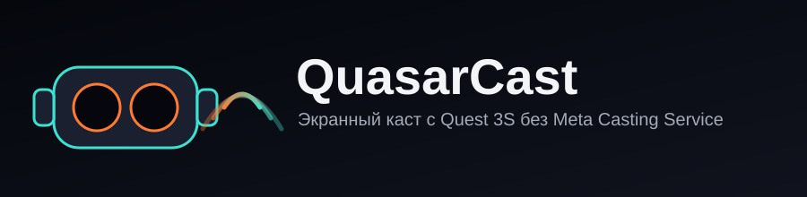

<p align="center">
  
</p>

<p align="center">
  
  
  
  
</p>

# QuasarCast

Трансляция экрана Meta Quest (2 / 3 / 3S / Pro) в браузер по локальной сети — без
зависимостей от системного сервиса кастинга Meta. Приложение ставится на шлем,
захватывает собственный экран через штатный Android API `MediaProjection` и
раздаёт видео на веб-страницу, открываемую с телефона, ноутбука или ТВ в той же
Wi-Fi-сети.

## Скриншоты

<!-- screenshots-placeholder -->
*(скоро)*

## Почему не через системный каст Meta

На части прошивок Horizon OS системный сервис `com.oculus.magicislandcastingservice`
принимает команду подключения только от приложений, подписанных ключом Meta —
сторонние приложения получают отказ без внятной причины. QuasarCast обходит это,
используя обычный Android-API записи экрана (`MediaProjection` + `MediaCodec`),
доступный любому приложению после разового системного подтверждения пользователем.
Проверено: захватывается именно VR-сцена игры, а не плоская 2D-панель.

## Возможности

- Захват экрана шлема через `MediaProjection`, кодирование в H.264 (`MediaCodec`,
  аппаратный энкодер).
- Раздача по HTTP/WebSocket (Media Source Extensions) с задержкой порядка
  0.1–0.3 с.
- Защита 6-значным кодом подключения, можно передать прямо в URL
  (`?code=123456`), код также выводится как QR для сканирования с телефона.
- Несколько одновременных зрителей; опоздавший зритель сам подхватывает поток
  с ближайшего ключевого кадра.
- Настройка формата кадра (16:9, 4:3, 1:1, 9:16, «как в шлеме»), качества
  (720p/1080p/1440p), битрейта и частоты кадров, плюс быстрые пресеты
  «слабый Wi-Fi» / «максимум качества».
- Индикатор уровня сигнала Wi-Fi перед запуском трансляции.
- Интерфейс на русском и английском (переключается в настройках).
- Фоновая работа: трансляция продолжается при сворачивании приложения и
  переходе в игру.

## Ограничения

- Звук приложений пока не захватывается (переключатель в настройках ничего не
  делает — это известный пробел, см. «Возможные доработки»).
- Каждый запуск трансляции требует подтвердить системный диалог Android
  «Начать запись экрана» — убрать его полностью без Accessibility-сервиса
  нельзя (см. ниже).
- Разрешение шлема — то, что выдаёт его собственный компоузер; специального
  рендеринга под каждый глаз отдельно нет и не требуется для простого
  зрительского потока.

## Возможные доработки (не реализовано)

- Автоматическое подтверждение диалога записи экрана через Accessibility
  Service — чтобы трансляция стартовала одним нажатием, без диалога на
  каждый раз.
- Захват звука приложений через `AudioPlaybackCapture` (API 29+).
- HTTP-эндпоинт для удалённого старта/стопа трансляции (полезно для
  управления несколькими шлемами из одной админ-панели, например в VR-клубе).
- Запись потока на диск сервера.

Если допилите что-то из этого — пул-реквесты приветствуются.

## Сборка

Нужен JDK 17+ и Android SDK (platform 37, build-tools 37.0.0). Gradle сам
подхватит нужный JDK через foojay-resolver, если локального не найдёт.

```bash
./gradlew assembleRelease
```

APK будет в `app/build/outputs/apk/release/app-release-unsigned.apk`. Его нужно
подписать перед установкой (debug-ключ подходит для личного использования):

```bash
keytool -genkeypair -keystore debug.jks -storepass android -keypass android \
  -alias debug -keyalg RSA -keysize 2048 -validity 10000 -dname "CN=QuasarCast"

$ANDROID_HOME/build-tools/37.0.0/zipalign -f 4 \
  app/build/outputs/apk/release/app-release-unsigned.apk aligned.apk

$ANDROID_HOME/build-tools/37.0.0/apksigner sign \
  --ks debug.jks --ks-pass pass:android --out quasarcast.apk aligned.apk
```

Либо просто скачать готовый APK из [Releases](../../releases).

## Установка на шлем

1. Включить режим разработчика на шлеме (через приложение Meta Quest на
   телефоне) и разрешить отладку по USB/ADB.
2. `adb install -r quasarcast.apk`, либо скопировать APK на шлем и установить
   через файловый менеджер / `pm install`.
3. Приложение появится в «Библиотека → Неизвестные источники».

## Как пользоваться

1. Открыть QuasarCast в шлеме, нажать на круглую кнопку — «Начать».
2. Подтвердить системный диалог Android «Разрешить запись экрана».
3. На экране появится QR-код, адрес (`http://192.168.x.x:PORT`) и 6-значный
   код подключения.
4. Открыть этот адрес на любом устройстве в той же сети (или отсканировать
   QR), ввести код — или сразу перейти по `http://192.168.x.x:PORT?code=123456`.
5. На странице зрителя: «Включить звук» для аудио (когда звук будет
   реализован), `F` — полный экран, `M` — выключение звука.

Управление через ADB (без захода в меню приложения):

```bash
adb shell am start -n org.quasarcast.app/xyz.lukioff.webstreamvr.MainActivity \
  -a xyz.lukioff.webstreamvr.START
adb shell am start -n org.quasarcast.app/xyz.lukioff.webstreamvr.MainActivity \
  -a xyz.lukioff.webstreamvr.STOP
```

(Через ADB всё равно придётся один раз подтвердить системный диалог записи
экрана руками — обойти это может только Accessibility Service, см. выше.)

## Происхождение и лицензия

Это производная работа от
[TheNightlyGod/WebStream-VR](https://github.com/TheNightlyGod/WebStream-VR):
веб-сервер, WebSocket-раздача и сканирование H.264 NAL-юнитов взяты из
оригинального проекта почти без изменений, а слой захвата экрана полностью
переписан — вместо подписанного протокола сервиса кастинга Meta используется
штатный `MediaProjection`.

Проект распространяется под **GNU AGPLv3** — той же лицензией, что и
оригинал (см. [`LICENSE`](LICENSE)). Это означает, в частности, что любая
производная версия, в том числе развёрнутая как сетевой сервис, обязана
оставаться под AGPLv3 с открытым исходным кодом.
